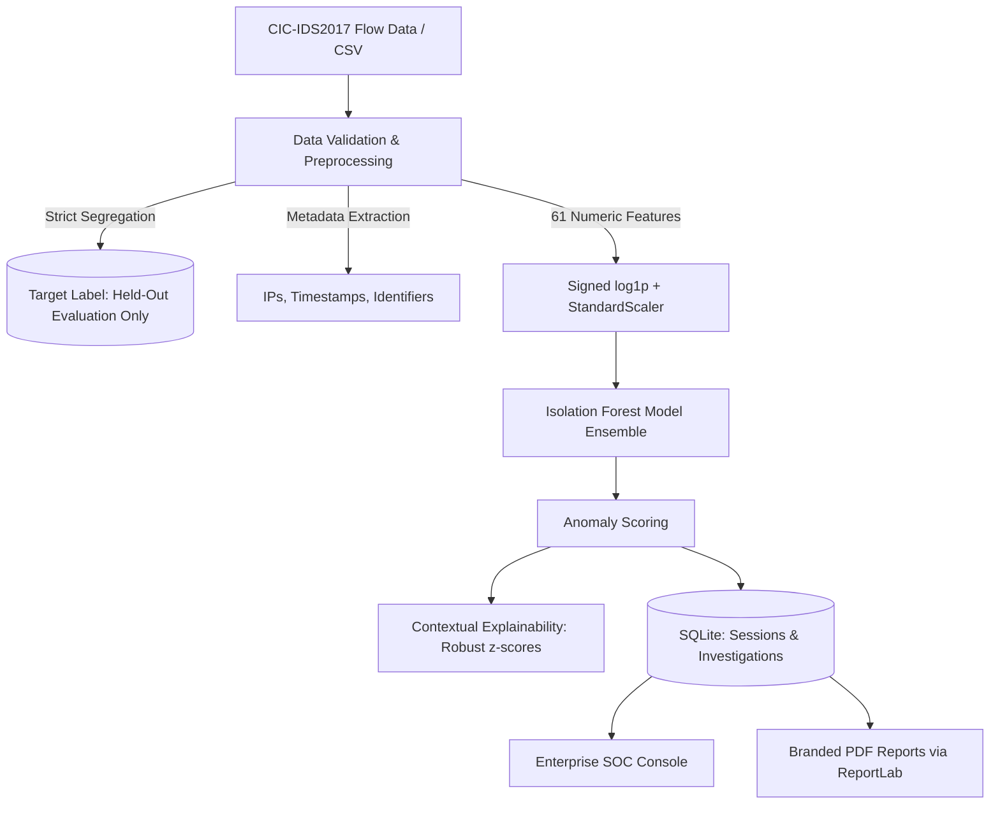

# SENTINEL AI: Cybersecurity Log Anomaly Discovery
### *See Beyond the Traffic. Detect Before the Threat.*

SENTINEL AI is an unsupervised network-flow anomaly discovery system using CIC-IDS2017 and a saved Isolation Forest model. A FastAPI backend serves the model, while a React + TypeScript dashboard supports CSV uploads, scoring, and investigations. A flag means **worth investigating**, not **confirmed attack**.

## Contents

- [Architecture](#1-system-architecture)
- [Setup and Run](#2-setup-and-run)
- [Project Structure](#3-project-structure)
- [Investigation Workflow](#4-core-investigation-workflow)
- [Dataset and Preprocessing](#5-dataset-and-preprocessing)
- [Model Comparison](#6-model-comparison)
- [Why Isolation Forest](#7-why-isolation-forest)
- [Integrity Rules](#8-integrity-rules)
- [Console Features](#9-console-features)
- [Limitations](#10-limitations)
- [Verification](#11-verification)

---

## 1. System Architecture



---

## 2. Setup and Run

Run the backend in one terminal from the repository root:

```bash
cd sentinel-backend
python -m venv .venv
source .venv/bin/activate
pip install -r requirements.txt
uvicorn app.main:app --reload --port 8000
```

The saved model and scaler must be present in `sentinel-backend/model/`. Use the scikit-learn version that matches the version used to train them. API docs: [http://localhost:8000/docs](http://localhost:8000/docs).

Run the frontend in a second terminal from the repository root:

```bash
cd sentinel-frontend
npm install
npm run dev
```

Open [http://localhost:5173](http://localhost:5173). The Vite development server proxies local `/api` requests to the backend on port `8000`.

For Vercel Production, set `VITE_API_BASE_URL=https://cyber-anamoly.onrender.com` and redeploy after changing it. The `VITE_` variable is public browser configuration; do not put secrets in it.

## 3. Project Structure

```text
.
├── .gitignore
├── README.md
├── Model_Traning.ipynb
├── Tuesday-WorkingHours.pcap_ISCX.csv # local source capture; ignored
├── sample_inputs.csv                  # tracked sample input
├── sample_labels.csv                  # tracked sample labels
├── artifacts/                         # local model experiments; ignored
├── data/                              # local workspace data
├── export/                            # model export configuration and metrics
├── gemini_generated_video_e39df147.mp4
├── sentinel-backend.zip
├── sentinel-backend/
│   ├── app/
│   │   ├── main.py
│   │   └── pdf_generator.py
│   ├── data/
│   │   └── demo_cicids2017.csv
│   ├── model/
│   │   ├── config.json
│   │   ├── iforest.joblib
│   │   ├── metrics.json
│   │   └── scaler.joblib
│   └── requirements.txt
└── sentinel-frontend/
    ├── public/
    ├── src/
    │   ├── components/
    │   ├── features/
    │   ├── lib/
    │   ├── pages/
    │   └── App.tsx
    ├── package.json
    └── vite.config.ts
```

The full Tuesday capture is local and ignored by Git. This repository currently tracks the model files under `sentinel-backend/model/` and the stratified demo CSV so Render can load them. Ignore rules apply only to new, untracked files; they do not remove files already committed. Keep runtime model files in `sentinel-backend/model/` unless the deployment storage is changed.

---

## 4. Core Investigation Workflow

1. **Overview Dashboard**: Monitor real-time flow counts, normal vs anomalous volume trends, Threat Radar sweeps, and dataset health scores.
2. **Traffic Analyzer (Core)**: Upload a compatible CSV or run the real CIC-IDS2017 demo sample, inspect its schema, configure the threshold, run detection, review calculated results, and triage flagged records in the **Investigation Drawer**.
3. **Threat Investigations**: Drag items across the Kanban board (`New` → `Under Investigation` → `Resolved` → `False Positive`), with changes persisted to SQLite.
4. **Report Export**: Download branded PDF threat reports generated via ReportLab or streaming CSV exports.

---

## 5. Dataset and Preprocessing

### Dataset source and labels

The project uses the CIC-IDS2017 Tuesday-WorkingHours `MachineLearningCSV` file. It contains **445,909 network flows** and **79 columns**: 78 numeric features plus `Label`. Removing **264 rows** with missing or infinite values leaves **445,645 flows**.

| Label | Flows | Description |
|---|---:|---|
| BENIGN | 432,074 | Normal traffic |
| FTP-Patator | 7,938 | Patator password-guessing (brute-force) attacks against FTP, port 21 |
| SSH-Patator | 5,897 | Patator password-guessing (brute-force) attacks against SSH, port 22 |

These counts are for this one Tuesday file, not the complete CIC-IDS2017 dataset. Attacks are about **3%** of the file. The demo sample is stratified from these real flows: 3,200 BENIGN, 220 FTP-Patator, and 180 SSH-Patator.

The feature set describes forward/backward packet counts and sizes, flow duration, bytes and packets per second, inter-arrival times (IAT), TCP flag counts, window sizes, and active/idle times.

### Feature reduction

| Stage | Columns | Action |
|---|---:|---|
| Initial | 78 | Numeric features; `Label` is separate |
| Constant-column removal | 68 | Remove 10 constant columns |
| Duplicate-column removal | 62 | Remove 6 duplicates: Subflow Fwd Packets, Subflow Bwd Packets, Subflow Fwd Bytes, Avg Fwd Segment Size, SYN Flag Count, Fwd Header Length.1 |
| Leakage-risk exclusion | 61 | Exclude Destination Port because ports 21 and 22 nearly reveal attacks in this one-day capture |
| Final model input | 61 | Features consumed by the models |

### Preprocessing and evaluation split

- Apply signed `log1p`, then `StandardScaler`; fit the scaler using normal training data only.
- Keep `Label` out of every model input; use it only for evaluation.
- Split normal flows into 70% training, 10% validation, and 20% test. Split attack flows into 30% validation and 70% test.
- Train on normal traffic only, tune using validation data, and use the test set once for final evaluation.

The one-click demo is a stratified sample of **3,600 real rows** from the source file. Its features and labels are real CIC-IDS2017 values. Source IP, destination IP, protocol, and timestamp displayed in the application are generated demo metadata and are never model inputs.

## 6. Model Comparison

Results are on the held-out test set using the alert line at the 95th percentile of normal-traffic scores, corresponding to about 5% false alarms.

| Model | PR-AUC | ROC-AUC | Precision | Recall | False-positive rate | FTP-Patator caught | SSH-Patator caught |
|---|---:|---:|---:|---:|---:|---:|---:|
| Isolation Forest | 0.474 | 0.783 | 0.531 | 0.516 | 0.051 | 89.1% | 1.1% |
| One-Class SVM | 0.114 | 0.607 | 0.014 | 0.007 | 0.051 | 1.2% | 0.0% |
| DBSCAN | n/a | n/a | 0.010 | 0.006 | 0.072 | 0.8% | 0.4% |

Random guessing gives a PR-AUC of about 0.10 because attacks make up about 10% of the test set.

### Tuned settings and comparison context

- Isolation Forest uses 100 trees, with each tree using all 302,269 training flows.
- One-Class SVM uses `nu=0.01`, `gamma="scale"`, and a 20,000-flow sample of normal traffic.
- DBSCAN uses 10 PCA components, `min_samples=10`, and `eps` selected from the k-distance curve. It is evaluated on a 30,000-flow test sample. DBSCAN has no `predict()` or continuous anomaly score, so ROC-AUC and PR-AUC do not apply.
- Plain Isolation Forest first achieved PR-AUC about 0.13. The log transform, use of all training data per tree, and validation tuning raised it to 0.474.

### Qualitative comparison

| Criteria | Isolation Forest | One-Class SVM | DBSCAN |
|---|---|---|---|
| Learning type | Unsupervised | Unsupervised | Unsupervised |
| Training data | Normal traffic only | Normal traffic only | No training; clusters the data |
| Anomaly score | Yes; flows can be ranked | Yes; decision function | No; noise yes/no |
| Scales to large data | Yes; about 10 s to train on 302,269 flows | Slow; trained on a 20,000-flow sample | Expensive; evaluated on a 30,000-flow sample |
| Main parameters | Trees, samples per tree | `nu`, `gamma` | `eps`, `min_samples` |
| Result here | Best | About random | Worse than random |

## 7. Why Isolation Forest

- It trains using normal traffic only, so labelled attacks are not needed for training.
- It assigns every flow an anomaly score. Analysts can rank flows and adjust the alert threshold; DBSCAN only says whether a point is noise.
- It is fast and scales to hundreds of thousands of flows; this configuration trains in about 10 s on 302,269 flows.
- The choice was measured, not assumed: with the same data and tuning effort it achieved PR-AUC 0.474 versus 0.114 for One-Class SVM. DBSCAN's flagged points were less likely to be attacks than average.
- Brute-force attempts repeat similar patterns thousands of times and form dense groups. DBSCAN can treat those as normal clusters, while One-Class SVM's boundary did not separate them effectively in this experiment.

## 8. Integrity Rules

- **Zero Label Leakage**: The `Label` column is strictly isolated prior to preprocessing, scaling, and training. It is accessed solely for post-inference benchmarking on held-out test splits.
- **No Fabricated Numbers**: The benchmark table reports the supplied held-out results. Live session metrics and timings are computed from the current input and threshold.
- **Anomaly ≠ Malicious**: The Isolation Forest detects statistical outliers in feature space; anomalies are phrased as *"flagged for investigation"*, never classified as attacks unless backed by ground-truth labels.
- **Contextual Deviation Notice**: Feature deviations represent robust z-scores against normal baseline traffic medians and do not reconstruct the exact random hyper-plane decision tree path.

---

## 9. Console Features

| Module | Navigation | Highlights |
|---|---|---|
| **Overview** | Main | KPIs, area volume ingress chart, threat donut, compact Threat Radar, recent events |
| **Live Monitor** | Main | Real-time simulated flow stream, pause/resume, severity filter, events/sec sparkline |
| **Traffic Analyzer** | Main | Guided upload, schema inspection, detection, results, record filtering, CSV/PDF export |
| **Threat Investigations** | Main | Kanban board & table view, PATCH status persistence, configurable triage policy |
| **Network Intelligence**| Main | Interactive SVG force-directed topology, packet animations, target port distribution |
| **Security Analytics** | Analytics | Cross-filtering charts for protocols, source IPs, score distribution, and feature overlays |
| **Detection History** | Analytics | SQLite archive of past sessions, reopen runs, delete, anomaly trend sparkline |
| **Project Work** | Workspace | Academic research workspace, class imbalance visuals, feature reduction drop report |
| **Dataset Explorer** | Workspace | Column browser, dtypes, null percentages, Pearson correlation heatmap |
| **Model Laboratory** | Workspace | Model parameters, fair One-Class SVM & DBSCAN benchmark, interactive tree demo |
| **Methodology** | Workspace | Interactive engineering flow with shortcuts to console views |
| **Settings** | System | Severity percentile policy sliders, API URL configuration, engine defaults |
| **About SENTINEL** | System | Product vision, technology stack, architecture diagram, known limitations |

---

## 10. Limitations

- **SSH-Patator is mostly missed (about 1%)**: An individual SSH attempt looks ordinary as a single flow. Time-window features, such as flows per source IP per minute, are a planned improvement.
- **A high score is not necessarily a worse flow**: Some of the highest-scoring flows were harmless large transfers, while FTP-Patator flows sat in a narrow band just below them.
- **Limited coverage**: Evaluation uses one day of one dataset. Real networks can also contain legitimate FTP and SSH traffic.
- **Simulated metadata**: Source IP, destination IP, protocol, and timestamp shown by the app are simulated demo values because the input file does not contain them. They are never model inputs.
- **A flag is not a verdict**: A flagged flow is worth investigating, not a confirmed attack.
- **Contextual explanations**: Feature deviations are indicators, not exact Isolation Forest decision paths. One-Class SVM and DBSCAN are offline comparisons; Isolation Forest is the live model.

---

## 11. Verification

Check that the backend responds:
```bash
curl http://localhost:8000/api/health
```

Build the frontend:
```bash
cd sentinel-frontend
npm run build
```
