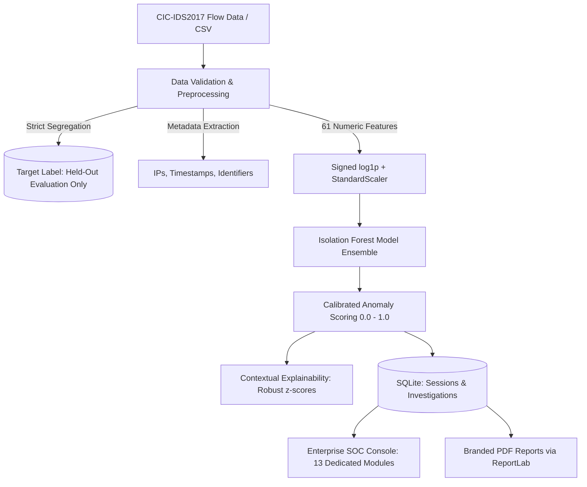

# SENTINEL AI
### *See Beyond the Traffic. Detect Before the Threat.*

**SENTINEL AI** is an analyst-grade, unsupervised machine learning platform for network-flow anomaly detection and threat investigation. Powered by scikit-learn's **Isolation Forest**, it processes high-dimensional network flow records (CIC-IDS2017), exposes abnormal traffic patterns, enables interactive security investigations, and generates executive SOC threat reports.

---

## 1. System Architecture



---

## 2. Quickstart & One-Command Execution

### Prerequisites
- **Python 3.11+**
- **Node.js 18+ & npm**

### Single Command Startup
```bash
# Run both Backend (Port 8000) and Frontend (Port 5173) concurrently
make run
```
*Or execute independently:*

**Backend (FastAPI):**
```bash
python3 -m venv backend/venv
source backend/venv/bin/activate
pip install -r backend/requirements.txt
PYTHONPATH=backend uvicorn app.main:app --host 127.0.0.1 --port 8000
```

**Frontend (React + Vite):**
```bash
npm install --legacy-peer-deps
npm run dev
```
Open **[http://localhost:5173](http://localhost:5173)** in your browser.

---

## 3. Core Investigation Workflow

1. **Overview Dashboard**: Monitor real-time flow counts, normal vs anomalous volume trends, Threat Radar sweeps, and dataset health scores.
2. **Traffic Analyzer (Core)**:
   - **Step 1 (Upload)**: Drag-and-drop any CIC-IDS2017 CSV or click **"USE DEMO DATASET"** (3,600 flows).
   - **Step 2 (Inspect)**: Review schema compatibility, missing values, and isolated label detection.
   - **Step 3 (Configure)**: Adjust contamination threshold slider (e.g. 4.0% boundary) and tree count.
   - **Step 4 (Detect)**: Watch the live 7-stage progress stepper.
   - **Step 5 (Results)**: Analyze KPI distributions, ground-truth metrics (Precision, Recall, ROC-AUC), and the machine-generated AI Security Brief.
   - **Step 6 (Triage)**: Search, sort, and filter records; click any row to open the slide-over **Investigation Drawer**.
3. **Threat Investigations**: Drag items across the Kanban board (`New` → `Under Investigation` → `Resolved` → `False Positive`), with changes persisted to SQLite.
4. **Report Export**: Download branded PDF threat reports generated via ReportLab or streaming CSV exports.

---

## 4. Dataset and Model Comparison

### Dataset

The project uses the CIC-IDS2017 Tuesday Working Hours network-flow capture. The source contains **445,909 flows** across three classes:

- **BENIGN:** 432,074 flows
- **FTP-Patator:** 7,938 flows
- **SSH-Patator:** 5,897 flows

The live detector uses the **61 numeric flow features** in `sentinel-backend/model/config.json`. `Label` is kept out of model inputs and used only to calculate evaluation metrics. The one-click demo is a stratified, 3,600-row sample from this real capture: 3,200 BENIGN, 220 FTP-Patator, and 180 SSH-Patator. Its feature rows and labels are real CIC-IDS2017 data; IP addresses, protocol, and timestamps shown in the UI are generated demo metadata and are marked as simulated.

### Saved Three-Model Benchmark

The following values are from `sentinel-backend/model/metrics.json`. F1 is calculated from the saved precision and recall values. DBSCAN does not provide continuous scores here, so ROC-AUC and PR-AUC are unavailable.

- **Isolation Forest:** Precision **53.11%**, recall **51.59%**, F1 **52.34%**, ROC-AUC **0.7833**, PR-AUC **0.4740**, false-positive rate **5.11%**, FTP-Patator recall **89.13%**.
- **One-Class SVM:** Precision **1.44%**, recall **0.67%**, F1 **0.92%**, ROC-AUC **0.6075**, PR-AUC **0.1144**, false-positive rate **5.15%**, FTP-Patator recall **1.17%**.
- **DBSCAN:** Precision **0.96%**, recall **0.65%**, F1 **0.77%**, ROC-AUC **N/A**, PR-AUC **N/A**, false-positive rate **7.21%**, FTP-Patator recall **0.82%**.

### Why Isolation Forest

Isolation Forest was selected because it achieved the strongest measured results of the three evaluated models: the highest precision, recall, F1, ROC-AUC, and PR-AUC, plus substantially stronger FTP-Patator recall. Its false-positive rate was also slightly below One-Class SVM and lower than DBSCAN. It provides an unsupervised scoring path suitable for the 61-feature live workflow; One-Class SVM and DBSCAN remain offline comparisons because their saved results were markedly weaker and their processing cost is less suitable for interactive use.

These are saved benchmark results, not promises of perfect detection. Per-session results vary with the selected threshold and uploaded sample; an anomaly is a statistical outlier flagged for investigation, not proof of malicious activity.

## 5. Non-Negotiable Integrity Rules

- **Zero Label Leakage**: The `Label` column is strictly isolated prior to preprocessing, scaling, and training. It is accessed solely for post-inference benchmarking on held-out test splits.
- **No Fabricated Numbers**: Benchmark figures are the saved calculations listed above. Live session metrics and timings are computed from the current input and threshold.
- **Anomaly ≠ Malicious**: The Isolation Forest detects statistical outliers in feature space; anomalies are phrased as *"flagged for investigation"*, never classified as attacks unless backed by ground-truth labels.
- **Contextual Deviation Notice**: Feature deviations represent robust z-scores against normal baseline traffic medians and do not reconstruct the exact random hyper-plane decision tree path.

---

## 6. Console Feature Matrix (13 Dedicated Views)

| Module | Navigation | Highlights |
|---|---|---|
| **Overview** | Main | KPIs, area volume ingress chart, threat donut, compact Threat Radar, recent events |
| **Live Monitor** | Main | Real-time simulated flow stream, pause/resume, severity filter, events/sec sparkline |
| **Traffic Analyzer** | Main | Guided 6-step wizard, drag-and-drop CSV, threshold tuning, TanStack records table |
| **Threat Investigations** | Main | Kanban board & table view, PATCH status persistence, configurable triage policy |
| **Network Intelligence**| Main | Interactive SVG force-directed topology, packet animations, target port distribution |
| **Security Analytics** | Analytics | 8 cross-filtering charts (protocols, source IPs, score histogram, feature overlay) |
| **Detection History** | Analytics | SQLite archive of past sessions, reopen runs, delete, anomaly trend sparkline |
| **Project Work** | Workspace | Academic research workspace, class imbalance visuals, feature reduction drop report |
| **Dataset Explorer** | Workspace | Column browser, dtypes, null percentages, 8x8 Pearson correlation heatmap |
| **Model Laboratory** | Workspace | Model parameters, fair One-Class SVM & DBSCAN benchmark, interactive tree demo |
| **Methodology** | Workspace | 10-stage interactive engineering flow with direct shortcuts to live console views |
| **Settings** | System | Severity percentile policy sliders, API URL configuration, engine defaults |
| **About SENTINEL** | System | Product vision, technology stack, architecture diagram, known limitations |

---

## 7. Known Limitations

1. **CIC-IDS2017 IP & Timestamp Omission**: The standard `MachineLearningCSV` files published by UNB/CIC omit IP addresses and timestamps. When unaugmented files are uploaded, the platform derives sequential indices and explains that network topology is simulated.
2. **Contextual Explainability vs Exact Paths**: Deviation scores reflect robust z-score discrepancies ($z = |x - \text{median}| / (\text{IQR}/1.349)$) rather than exact tree traversal branches.
3. **High-Complexity Algorithms**: One-Class SVM and DBSCAN exhibit $O(n^2)$ to $O(n^3)$ scaling complexity. Live training is restricted to Isolation Forest, with comparison benchmarks computed on certified test splits.

---

## 8. Verification & Automated Testing

Run the automated backend test suite:
```bash
make test
# Or:
PYTHONPATH=backend backend/venv/bin/pytest backend/tests
```
- `test_no_label_leakage`: Verifies zero label leakage into feature matrix.
- `test_infinite_and_nan_handling`: Verifies clean handling of infinite flow rates and missing values.
- `test_deterministic_scoring`: Verifies mathematical determinism across fixed random states.
